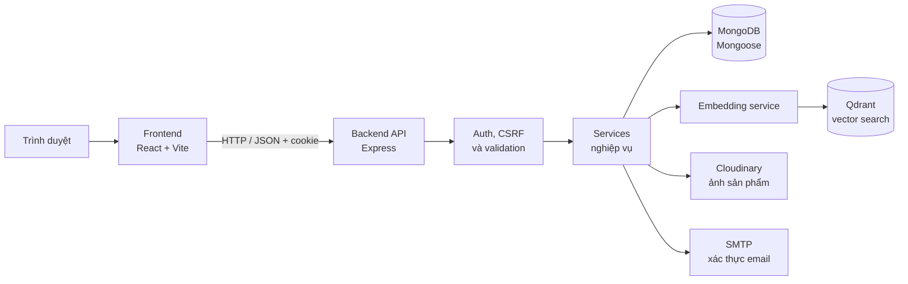

# DỰ ÁN TECHGEAR SHOP (MERN STACK)

Chào mừng bạn đến với dự án TechGear Shop. Đây là hệ thống website thương mại điện tử bán máy tính và linh kiện, bao gồm Frontend (React + Vite) và Backend (Node.js + Express + MongoDB).

## 📚 TÀI LIỆU DỰ ÁN (QUAN TRỌNG)

Trước khi bắt đầu code, mọi thành viên (và AI) **bắt buộc** phải đọc các tài liệu sau:

- **Bộ quy tắc Code:** Đọc trong thư mục `.github/instructions/`.
- **Tài liệu SRS (Đặc tả yêu cầu):** Đọc trong thư mục `docs/` (từ file 01 đến 05).
- **Tiến độ Backend:** Đọc file `docs/BACKEND_PROGRESS.md` để biết API nào đã hoàn thiện và sẵn sàng tích hợp.

## Kiến trúc tổng quan



### Các module chính

| Module | Trách nhiệm | Vị trí |
| --- | --- | --- |
| Frontend | Cửa hàng, trang quản trị, trạng thái phiên và gọi API | `src/frontend/src/` |
| API & routes | Định tuyến HTTP và middleware bảo vệ/kiểm tra request | `src/backend/server.js`, `src/backend/routes/`, `src/backend/middleware/` |
| Controllers | Ánh xạ request/response và gọi service | `src/backend/controllers/` |
| Services | Nghiệp vụ auth, sản phẩm, giỏ hàng, đơn hàng, tìm kiếm | `src/backend/services/` |
| Models | Schema và truy cập dữ liệu MongoDB | `src/backend/models/` |
| Vector search | Tạo embedding và tìm kiếm/đồng bộ vector | `src/backend/services/embedding.service.js`, `src/backend/services/semanticSearch.service.js`, `src/backend/services/qdrantSync.service.js` |
| Tích hợp ngoài | Email xác thực và lưu trữ ảnh | `src/backend/utils/mailer.js`, Cloudinary config/services |

Chi tiết các luồng đăng ký, checkout, semantic search và đồng bộ Qdrant: [docs/ARCHITECTURE.md](docs/ARCHITECTURE.md).

## 🚀 Quick start

Yêu cầu: Node.js 20 trở lên, MongoDB và npm. Mở hai terminal tại thư mục gốc repository.

### 1. Backend

```powershell
cd src/backend
Copy-Item .env.example .env
npm install
```

Điền `MONGODB_URI`, `JWT_SECRET` và thông tin tích hợp cần dùng trong `src/backend/.env`. Để bật xác thực email, cấu hình SMTP. Semantic search cần Qdrant và model embedding được cấu hình trong môi trường.

```powershell
npm run dev
```

Backend mặc định chạy tại `http://localhost:5000`; health check: `http://localhost:5000/api/health`.

### 2. Frontend

Trong terminal thứ hai:

```powershell
cd src/frontend
Copy-Item .env.example .env
npm install
npm run dev
```

`VITE_API_URL` mặc định trong file mẫu là `http://localhost:5000/api`. Vite sẽ hiển thị địa chỉ giao diện, thường là `http://localhost:5173`.

### Lệnh backend hữu ích

- `npm run seed:admin` — tạo tài khoản Admin ban đầu theo cấu hình môi trường.
- `npm run index:products` — lập chỉ mục sản phẩm vào Qdrant.
- `npm test` — chạy các test Node.js hiện có.

## 🧠 AI Tooling

Cài skill bảo mật cho GitHub Copilot:

```bash
npx skills add rightcodehere/skills --skill rc-codeprobe-security -a github-copilot
```

Các skill cốt lõi hiện có:

- **BE core:** `rc-api-forge`, `rc-auth-architect`, `rc-code-review`, `rc-tdd`.
- **Audit:** `rc-codeprobe-security`, `rc-codeprobe-architecture`, `rc-codeprobe-performance`, `rc-codeprobe-error-handling`.
- **Git:** `rc-git-guardrails`, `rc-git-commit-push`.
- **Security:** `scar-tissue`, `security-baseline`, `ai-repo-safety`.

Xem [hướng dẫn setup skill chi tiết](docs/DEVELOPMENT_SETUP.md), bao gồm các reference dùng chung và lưu ý bảo mật khi cài.

## ⚠️ Checklist trước khi deploy production
- [ ] Đặt `RATE_LIMIT_ENABLED=true` trong `.env` (hiện đang `false` để dev test)
- [ ] Đặt `COOKIE_SECURE=true` (production dùng HTTPS)
- [ ] Đổi `JWT_SECRET` sang secret mới, mạnh hơn (≥ 32 ký tự)
- [ ] Cập nhật `CLIENT_ORIGINS` thành domain thật (VD: `https://techgear.shop`)
- [ ] Đặt `NODE_ENV=production`
- [ ] Kiểm tra MongoDB Atlas IP whitelist (chỉ cho phép IP của server production)
- [ ] Bật Cloudinary upload preset bảo mật
