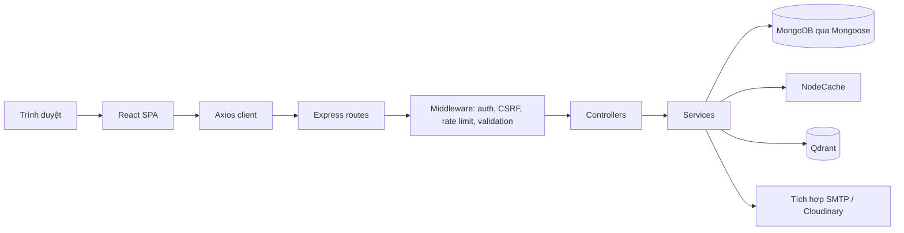
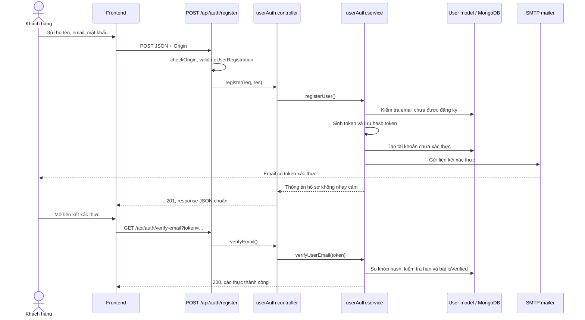
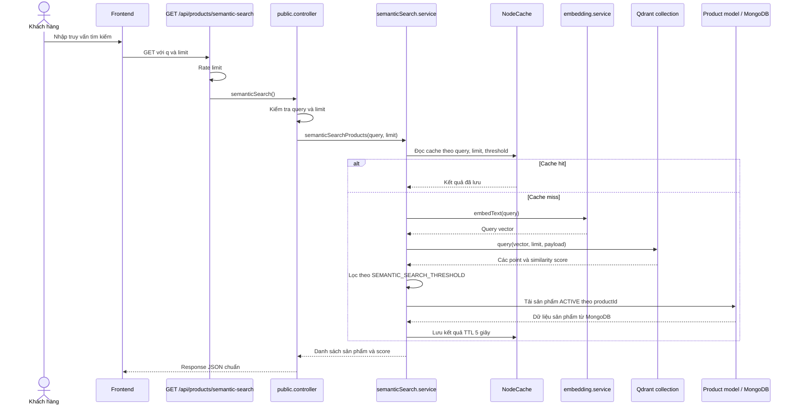

# Kiến trúc TechGear Shop

Tài liệu mô tả kiến trúc đang được triển khai trong mã nguồn: frontend SPA, backend API phân lớp, các kho dữ liệu và tích hợp ngoài. Backend hiện là một ứng dụng monolith, không phải hệ thống microservices.

## Thành phần

- **Frontend:** React + Vite SPA. React Router tổ chức route khách hàng và admin; Redux Toolkit lưu state dùng chung của giỏ hàng, so sánh và phiên đăng nhập. Các trang gọi API qua service wrappers và Axios client.
- **Backend:** một Express server cung cấp các nhóm API công khai, khách hàng, xác thực và admin. Middleware áp dụng bảo mật, xác thực, CSRF, rate limit và validation trước controller.
- **MongoDB:** nguồn dữ liệu chính cho người dùng, danh mục, sản phẩm, giỏ hàng, đơn hàng và log nghiệp vụ; truy cập qua Mongoose.
- **Qdrant:** lưu vector sản phẩm và payload để truy xuất ứng viên tìm kiếm ngữ nghĩa/tương tự. MongoDB được dùng để tải và xác minh dữ liệu sản phẩm trả về.
- **Embedding:** backend tạo vector từ truy vấn hoặc thông tin sản phẩm bằng mô hình embedding.
- **SMTP / Cloudinary:** backend gửi email xác thực và quản lý ảnh.

## Luồng request và phân lớp



Frontend khởi tạo route và Redux store tại [main.jsx](../src/frontend/src/main.jsx), [App.jsx](../src/frontend/src/App.jsx) và [store/index.js](../src/frontend/src/store/index.js). Axios được cấu hình tập trung trong [axiosClient.js](../src/frontend/src/api/axiosClient.js), bao gồm gửi cookie, CSRF header cho request ghi và xử lý một số phản hồi xác thực/rate limit.

Backend khởi tạo middleware và đăng ký route trong [server.js](../src/backend/server.js). Request thường đi theo luồng:

1. Route chọn middleware xác thực, CSRF, giới hạn tần suất và validation phù hợp với endpoint.
2. Controller kiểm tra kết quả validation, gọi service và định dạng response HTTP.
3. Service xử lý nghiệp vụ, truy vấn trực tiếp Mongoose models hoặc gọi tích hợp ngoài.

Hiện tại chưa có lớp repository riêng; các service đảm nhiệm cả nghiệp vụ và truy cập model. Response API theo dạng `success`, `message`, `data`, `errors`.

Các nhóm route frontend được cấu hình trong [App.jsx](../src/frontend/src/App.jsx); Redux slices hiện được ghép trong [store/index.js](../src/frontend/src/store/index.js). Backend đăng ký các nhóm route `/api/admin`, `/api/auth` và các route public/customer trong [server.js](../src/backend/server.js).

## Đăng ký và xác thực email



Mật khẩu được lưu theo cơ chế hash của model; token xác thực lưu dạng hash và chỉ dùng một lần trong thời hạn hiệu lực. Đăng ký bị lỗi gửi email sẽ xóa tài khoản vừa tạo.

## Checkout và lưu đơn hàng

```mermaid
sequenceDiagram
    actor Customer as Khách hàng
    participant FE as Frontend
    participant Route as POST /api/orders
    participant Auth as requireCustomerAuth / CSRF
    participant Controller as order.controller
    participant Service as orders/order.service
    participant Cart as Cart model / MongoDB
    participant Product as Product model / MongoDB
    participant Order as Order model / MongoDB
    participant Logs as InventoryLog + OrderHistory

    Customer->>FE: Xác nhận thanh toán
    FE->>Route: POST JSON + cookie phiên + CSRF header
    Route->>Auth: Xác thực user, Origin, CSRF và payload
    Auth-->>Route: Cho phép request
    Route->>Controller: createOrder()
    Controller->>Service: createOrder(req, payload)
    Service->>Order: Kiểm tra idempotencyKey hiện có
    Service->>Cart: Đọc giỏ ACTIVE của user
    Service->>Product: Đọc lại giá, trạng thái, danh mục và tồn kho
    Service->>Service: Tính tổng từ dữ liệu DB, so sánh clientTotal
    Service->>Product: Trừ tồn kho nguyên tử
    Service->>Order: Lưu đơn và snapshot sản phẩm
    Service->>Logs: Ghi log tồn kho và lịch sử trạng thái
    Service->>Cart: Xóa giỏ sau khi tạo đơn
    Note over Service,Cart: Ưu tiên transaction; chỉ dùng fallback khi MongoDB không hỗ trợ transaction
    Service-->>Controller: Đơn hàng, trackCode và trạng thái idempotent
    Controller-->>FE: 201 tạo mới hoặc 200 request lặp
    FE-->>Customer: Hiển thị kết quả đặt hàng
```

Khi transaction không khả dụng, service dùng luồng fallback với thao tác bù tồn kho/xóa dữ liệu nếu checkout thất bại. Giá và tổng tiền luôn được tính lại từ database; `idempotencyKey` ngăn tạo đơn lặp.

## Tìm kiếm ngữ nghĩa sản phẩm



Qdrant cung cấp ứng viên theo độ tương đồng; MongoDB là nguồn dữ liệu sản phẩm trả về và lọc trạng thái `ACTIVE`. Nếu không có điểm đạt threshold, service trả danh sách rỗng.
Cache sản phẩm dùng NodeCache với TTL mặc định 5 giây; Semantic Search và Similar Products cũng cấu hình TTL 5 giây.

## Đồng bộ sản phẩm với Qdrant

```mermaid
sequenceDiagram
    actor Admin as Admin
    participant FE as Frontend Admin
    participant Route as /api/admin/products
    participant Auth as Admin auth + CSRF
    participant Controller as product.controller
    participant Service as product.service
    participant Mongo as Product / Category models
    participant Sync as qdrantSync.service
    participant Embed as embedding.service
    participant Qdrant as Qdrant

    Admin->>FE: Tạo hoặc cập nhật sản phẩm
    FE->>Route: Request + admin_token + CSRF
    Route->>Auth: Xác thực quyền và kiểm tra request
    Auth->>Controller: Cho phép thao tác
    Controller->>Service: create/update/status/delete
    Service->>Mongo: Lưu thay đổi sản phẩm
    alt Sản phẩm ACTIVE được tạo hoặc cập nhật
        Service->>Mongo: Lấy tên danh mục
        Service->>Sync: upsertProductVector(product, categoryName)
        Sync->>Sync: Đảm bảo collection và payload index
        Sync->>Embed: Tạo embedding từ nội dung sản phẩm
        Embed-->>Sync: Product vector
        Sync->>Qdrant: Upsert point theo UUID deterministic
        Qdrant-->>Sync: Kết quả upsert
        Sync-->>Service: true/false; lỗi được log
    else Sản phẩm chuyển sang inactive/paused hoặc bị xóa
        Service->>Sync: deleteProductVector(productId)
        Sync->>Qdrant: Xóa point theo UUID deterministic
        Qdrant-->>Sync: Kết quả xóa
        Sync-->>Service: true/false; lỗi được log
    end
    Service-->>Controller: Trả kết quả CRUD MongoDB
    Controller-->>FE: Response API
```

MongoDB là luồng chính của CRUD. Lỗi embedding/Qdrant được log và không chặn response CRUD; sản phẩm không ACTIVE được gỡ khỏi Qdrant thay vì upsert.
